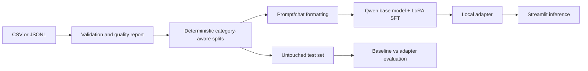

# PromptCraft AI

PromptCraft AI is a college-level prompt optimization project. It fine-tunes the open-weight
`Qwen/Qwen2.5-0.5B-Instruct` model with LoRA on the supplied prompt pairs, then exposes the
trained adapter through Streamlit. The canonical development dataset contains 100 AI-assisted draft records;
all records are marked `AI-assisted draft - human review required`, so this project does not
claim human-verified labels or strong generalization.

## Abstract and objectives

The application preserves a user's intent while adding useful audience, format, tone, and
scope detail. Objectives are to validate a custom dataset, prevent split leakage, perform
actual supervised fine-tuning, compare the untouched base model with the adapter on held-out
examples, and provide a transparent local inference UI.

## Architecture and data flow



Training workflow: inspect -> validate -> split -> format -> load tokenizer/model -> attach
LoRA -> supervised train -> save adapter -> evaluate. The base model is pretrained weights;
the adapter is the learned project artifact; Streamlit is only the application layer.
Fine-tuning updates trainable adapter weights and is not equivalent to calling an inference API.

## Dataset

The canonical development dataset is [data/promptcraft_custom_dataset_100.csv](data/promptcraft_custom_dataset_100.csv).
The original 82-row dataset is retained as [data/promptcraft_custom_dataset.csv](data/promptcraft_custom_dataset.csv)
for provenance and comparison. Both contain `id`, `category`, `input_prompt`,
`target_prompt`, `intended_audience`, `requirements`, `quality_label`, and `review_status`.
`input_prompt` is the user message and `target_prompt` is the supervised target. The original
files are never overwritten. Quality labels and review status are reported, not used as
ground truth. Near-duplicate inputs should be manually reviewed before academic evaluation.

The 100-row dataset was created from the unchanged 82-row source plus 18 additions. To recreate
that separate file from its inputs, run:

```bash
python scripts/create_augmented_dataset.py
```

This combines the unchanged 82-row source with
`data/promptcraft_ai_assisted_additions.csv` and writes
`data/promptcraft_custom_dataset_100.csv`. All 18 additions are explicitly marked
`AI-assisted draft - human review required` and `pending_human_rating`. Review all
100 rows before making academic quality claims.

## Setup

Use Python 3.10 or newer (the current macOS `/usr/bin/python3` is often 3.9 and is
too old for the declared dependencies). On macOS with Homebrew:

```bash
brew install python@3.11
/opt/homebrew/bin/python3.11 -m venv .venv
source .venv/bin/activate
# Windows PowerShell: .venv\Scripts\Activate.ps1
python -m pip install --upgrade pip
python -m pip install -r requirements.txt
```

After activation, `python` and `streamlit` resolve from `.venv`. If you do not want to
activate the environment, use `.venv/bin/python` and `.venv/bin/streamlit` explicitly.

Prepare the canonical 100-row development dataset on CPU:

```bash
python3 scripts/prepare_data.py \
  --input data/promptcraft_custom_dataset_100.csv \
  --output-dir data/processed
```

This writes `train.jsonl`, `validation.jsonl`, `test.jsonl`, `quality_report.json`,
`leakage_report.json`, and `split_manifest.json`. The manifest records the source filename,
SHA-256 hash, seed, split IDs, proportions, and preprocessing settings. The split is
deterministic with seed 42 and keeps categories grouped while preventing exact duplicate
pairs. A lexical leakage audit is reported but does not detect all semantic duplicates or
move records. With only 100 AI-assisted, unreviewed examples, resulting metrics are prototype
evidence, not a production benchmark.

## Actual fine-tuning

The reproducible experiment dataset is `data/processed_v2/`. It was prepared from the
canonical 100-row CSV with seed 42 and includes manifest-linked source and split hashes.
The older `data/processed/` directory is not overwritten by preparation. Before training,
verify the fresh manifest and split files:

```bash
python3 scripts/prepare_data.py \
  --input data/promptcraft_custom_dataset_100.csv \
  --output-dir data/processed_v2
```

On a CUDA machine or Google Colab T4:

```bash
python3 scripts/train.py \
  --data-dir data/processed_v2 \
  --output-dir models/promptcraft-colab-run-1 \
  --quantized
```

The command uses QLoRA when `--quantized` is supplied and saves the adapter to the
specified output directory. It evaluates and saves at the end of each epoch, selects the
checkpoint with the lowest validation `eval_loss`, loads that checkpoint before saving the
final adapter, and writes `experiment_metadata.json` with the selected checkpoint and
validation loss. The held-out test split is not loaded by the training script. On CPU, omit `--quantized`, but training will be impractically
slow and memory constrained. The defaults are three epochs, learning rate `2e-4`, effective
batch size 16 (batch 2 x accumulation 8), sequence length 512, LoRA rank 16, alpha 32, and
dropout 0.05. These are conservative starting points, not guarantees of quality.
On Apple Silicon, `--quantized` is rejected because bitsandbytes QLoRA requires CUDA; use
Google Colab for the practical training run.

The notebook [notebooks/promptcraft_finetuning.ipynb](notebooks/promptcraft_finetuning.ipynb)
contains the same Colab workflow. For a fresh Colab runtime, use:

```bash
!git clone https://github.com/YASHMETKAL/promptcraft-ai.git
%cd promptcraft-ai
!pip install -r requirements.txt
!python scripts/prepare_data.py --input data/promptcraft_custom_dataset_100.csv --output-dir data/processed_v2
!python - <<'PY'
import json
from pathlib import Path
manifest = json.loads(Path("data/processed_v2/split_manifest.json").read_text())
assert manifest["dataset"]["filename"] == "promptcraft_custom_dataset_100.csv"
assert set(manifest["split_sha256"]) == {"train", "validation", "test"}
print(manifest["counts"])
PY
!nvidia-smi
```

Only after those checks should you explicitly run:

```bash
!python scripts/train.py \
  --data-dir data/processed_v2 \
  --output-dir models/promptcraft-colab-run-1 \
  --quantized
```

Copy `models/promptcraft-colab-run-1/` and its `experiment_metadata.json` to persistent Drive or
download them after training. A GPU is required for practical training; preparation and
tests work without one.

The training script refuses non-empty output directories by default and never treats
`--output-dir` as a resume checkpoint. To resume an explicit valid checkpoint, pass
`--resume-from-checkpoint path/to/checkpoint`. To intentionally use an existing output
directory, pass `--allow-existing-output`; stale `experiment_metadata.json` is still
rejected unless an explicit resume checkpoint is supplied.

## Evaluation and application

After training, generate a three-way comparison using exactly the held-out test file:

```bash
python3 scripts/evaluate.py \
  --test data/processed/test.jsonl \
  --adapter models/promptcraft-lora \
  --output outputs/evaluation_results.csv \
  --seed 42
```

The comparison CSV includes the unchanged original prompt, a deterministic
prompt-engineering baseline, the fine-tuned output, contextual fields, and inference times.
The split manifest also records a SHA-256 hash for each prepared split. The evaluation guard
checks the held-out test IDs and the `test.jsonl` hash, so modifying the test file after
preparation is rejected. The command also writes `outputs/evaluation_results_ratings.csv` and
`outputs/evaluation_results_mapping.csv`. Candidate order is shuffled independently for
each example using the documented seed, and the mapping records the example ID, candidate
label, and system separately. Give reviewers only the ratings CSV when possible; it uses
candidate labels A/B/C. Keep the mapping CSV separate until ratings are complete. Evaluation
requires a `test.jsonl` whose IDs match the adjacent `split_manifest.json`; it does not
silently accept train or validation files. Existing output files are protected; pass
`--overwrite` only when intentionally replacing a prior evaluation artifact.
Rate intent preservation, specificity, relevance, usability, and unsupported assumptions
(where 5 means more problems) from 1 to 5. Rating fields are blank until a human evaluates
the outputs. Do not edit the test examples or use them for model selection, and do not
interpret the original prompt as a generated-system output.

Launch Streamlit only after an adapter exists:

```bash
python3 -m streamlit run app.py
```

The UI explicitly reports the adapter path and shows an error when it is missing; it never
silently falls back to the base model. Model files, generated reports, and processed data are
ignored by Git.

## Project structure

| Path | Purpose |
|---|---|
| `app.py` | Streamlit interface |
| `src/data_validation.py` | CSV/JSONL loading and quality checks |
| `src/dataset_preparation.py` | Formatting and deterministic splits |
| `src/model_loader.py` | Base model and adapter loading |
| `src/inference.py` | Generation and timing |
| `src/evaluation.py` | Paired evaluation CSV |
| `scripts/prepare_data.py` | Data preparation CLI |
| `scripts/train.py` | Actual LoRA/QLoRA SFT |
| `scripts/evaluate.py` | Baseline versus adapter CLI |
| `config/training_config.yaml` | Reproducible hyperparameters |
| `tests/` | Validation, preparation, and inference tests |

## Limitations and future work

The dataset is small, AI-assisted, and pending human review. Human ratings, multiple raters,
confidence intervals, topic-family grouping, and a larger reviewed corpus are needed before
claiming improvement. Future work can add semantic leakage detection, a stronger rubric,
checkpoint selection on validation loss, quantization benchmarking, and a model card.

## Troubleshooting

* **Missing adapter:** run preparation and `scripts/train.py`, then verify the adapter path.
* **CUDA out of memory:** use `--quantized`, reduce sequence length or batch size, and restart
  the runtime.
* **CPU or Apple Silicon training:** the current QLoRA path requires CUDA. Use Colab with a
  T4 or better for practical training; non-quantized local runs are for validation and
  smoke tests only.
* **Dependency/API errors:** use a fresh Python 3.10+ environment and the pinned major-version
  ranges in `requirements.txt`.
* **Unexpected output:** inspect the saved prompt template and ensure the tokenizer matches the
  base model; never report an empty generation as a successful result.

## Viva preparation

1. **Why LoRA?** It trains a small set of low-rank adapter matrices instead of all base weights,
   reducing memory and storage requirements.
2. **Why a held-out test set?** It estimates behavior on examples not used for training or
   checkpoint selection.
3. **Why is the dataset warning important?** AI-assisted, unreviewed labels can contain errors
   and cannot support human-authored or high-quality claims.
4. **Is this prompt engineering?** The input template helps format the task, but the required
   learned behavior comes from supervised weight updates to the LoRA adapter.
5. **What if fine-tuning is worse?** Report it honestly; small data, label noise, overfitting,
   and hyperparameters are plausible causes.

## Demonstration script

1. Show the source dataset and its provenance warning.
2. Run the preparation command and open `quality_report.json`.
3. Explain base weights, LoRA adapter, and held-out test data.
4. Show the training command and saved adapter path (without claiming success until it exits 0).
5. Run evaluation and discuss human rubric scores and inference times.
6. Launch Streamlit, submit one prompt, and point out the explicit fine-tuned mode.
