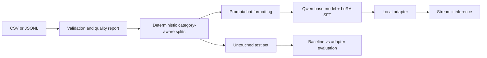

# PromptCraft AI

PromptCraft AI is a college-level prompt optimization project. It fine-tunes the open-weight
`Qwen/Qwen2.5-0.5B-Instruct` model with LoRA on the supplied prompt pairs, then exposes the
trained adapter through Streamlit. The supplied dataset contains 82 AI-assisted draft records;
all records are marked `AI-assisted draft - human review required`, so this project does not
claim human-verified labels or strong generalization.

## Abstract and objectives

The application preserves a user's intent while adding useful audience, format, tone, and
scope detail. Objectives are to validate a custom dataset, prevent split leakage, perform
actual supervised fine-tuning, compare the untouched base model with the adapter on held-out
examples, and provide a transparent local inference UI.

## Architecture and data flow



Training workflow: inspect -> validate -> split -> format -> load tokenizer/model -> attach
LoRA -> supervised train -> save adapter -> evaluate. The base model is pretrained weights;
the adapter is the learned project artifact; Streamlit is only the application layer.
Fine-tuning updates trainable adapter weights and is not equivalent to calling an inference API.

## Dataset

The canonical files are [data/promptcraft_custom_dataset.csv](data/promptcraft_custom_dataset.csv)
and `data/promptcraft_custom_dataset.jsonl`. Both contain `id`, `category`, `input_prompt`,
`target_prompt`, `intended_audience`, `requirements`, `quality_label`, and `review_status`.
`input_prompt` is the user message and `target_prompt` is the supervised target. The original
files are never overwritten. Quality labels and review status are reported, not used as
ground truth. Near-duplicate inputs should be manually reviewed before academic evaluation.

## Setup

Use Python 3.10 or newer (the current macOS `/usr/bin/python3` is often 3.9 and is
too old for the declared dependencies). On macOS with Homebrew:

```bash
brew install python@3.11
/opt/homebrew/bin/python3.11 -m venv .venv
source .venv/bin/activate
# Windows PowerShell: .venv\Scripts\Activate.ps1
python -m pip install --upgrade pip
python -m pip install -r requirements.txt
```

After activation, `python` and `streamlit` resolve from `.venv`. If you do not want to
activate the environment, use `.venv/bin/python` and `.venv/bin/streamlit` explicitly.

Prepare data on CPU:

```bash
python3 scripts/prepare_data.py \
  --input data/promptcraft_custom_dataset.csv \
  --output-dir data/processed
```

This writes `train.jsonl`, `validation.jsonl`, `test.jsonl`, `quality_report.json`, and
`split_manifest.json`. The split is deterministic with seed 42 and keeps categories grouped
while preventing exact duplicate pairs. With only 82 examples, the resulting metrics are
prototype evidence, not a production benchmark.

## Actual fine-tuning

On a CUDA machine or Google Colab T4:

```bash
python3 scripts/train.py --data-dir data/processed --quantized
```

The command uses QLoRA when `--quantized` is supplied and saves the adapter to
`models/promptcraft-lora`. On CPU, omit `--quantized`, but training will be impractically
slow and memory constrained. The defaults are three epochs, learning rate `2e-4`, effective
batch size 16 (batch 2 x accumulation 8), sequence length 512, LoRA rank 16, alpha 32, and
dropout 0.05. These are conservative starting points, not guarantees of quality.
On Apple Silicon, `--quantized` is rejected because bitsandbytes QLoRA requires CUDA; use
Google Colab for the practical training run.

The notebook [notebooks/promptcraft_finetuning.ipynb](notebooks/promptcraft_finetuning.ipynb)
contains the same Colab workflow. Upload the dataset, run preparation, train, and save the
adapter before evaluating. A GPU is required for practical training; preparation and tests
work without one.

## Evaluation and application

After training, generate paired outputs using exactly the held-out test file:

```bash
python3 scripts/evaluate.py \
  --test data/processed/test.jsonl \
  --adapter models/promptcraft-lora \
  --output outputs/evaluation_results.csv
```

The CSV includes both outputs and inference time. Fill the clarity, specificity, and intent
preservation columns using the documented 1-5 human rubric (intent preserved, clarity,
useful specificity, constraints included, naturalness). Blank subjective scores are not
treated as zero. Do not edit the test examples or use them for model selection.

Launch Streamlit only after an adapter exists:

```bash
python3 -m streamlit run app.py
```

The UI explicitly reports the adapter path and shows an error when it is missing; it never
silently falls back to the base model. Model files, generated reports, and processed data are
ignored by Git.

## Project structure

| Path | Purpose |
|---|---|
| `app.py` | Streamlit interface |
| `src/data_validation.py` | CSV/JSONL loading and quality checks |
| `src/dataset_preparation.py` | Formatting and deterministic splits |
| `src/model_loader.py` | Base model and adapter loading |
| `src/inference.py` | Generation and timing |
| `src/evaluation.py` | Paired evaluation CSV |
| `scripts/prepare_data.py` | Data preparation CLI |
| `scripts/train.py` | Actual LoRA/QLoRA SFT |
| `scripts/evaluate.py` | Baseline versus adapter CLI |
| `config/training_config.yaml` | Reproducible hyperparameters |
| `tests/` | Validation, preparation, and inference tests |

## Limitations and future work

The dataset is small, AI-assisted, and pending human review. Human ratings, multiple raters,
confidence intervals, topic-family grouping, and a larger reviewed corpus are needed before
claiming improvement. Future work can add semantic leakage detection, a stronger rubric,
checkpoint selection on validation loss, quantization benchmarking, and a model card.

## Troubleshooting

* **Missing adapter:** run preparation and `scripts/train.py`, then verify the adapter path.
* **CUDA out of memory:** use `--quantized`, reduce sequence length or batch size, and restart
  the runtime.
* **CPU training is slow:** use Colab with a T4; CPU mode is for validation and smoke tests.
* **Dependency/API errors:** use a fresh Python 3.10+ environment and the pinned major-version
  ranges in `requirements.txt`.
* **Unexpected output:** inspect the saved prompt template and ensure the tokenizer matches the
  base model; never report an empty generation as a successful result.

## Viva preparation

1. **Why LoRA?** It trains a small set of low-rank adapter matrices instead of all base weights,
   reducing memory and storage requirements.
2. **Why a held-out test set?** It estimates behavior on examples not used for training or
   checkpoint selection.
3. **Why is the dataset warning important?** AI-assisted, unreviewed labels can contain errors
   and cannot support human-authored or high-quality claims.
4. **Is this prompt engineering?** The input template helps format the task, but the required
   learned behavior comes from supervised weight updates to the LoRA adapter.
5. **What if fine-tuning is worse?** Report it honestly; small data, label noise, overfitting,
   and hyperparameters are plausible causes.

## Demonstration script

1. Show the source dataset and its provenance warning.
2. Run the preparation command and open `quality_report.json`.
3. Explain base weights, LoRA adapter, and held-out test data.
4. Show the training command and saved adapter path (without claiming success until it exits 0).
5. Run evaluation and discuss human rubric scores and inference times.
6. Launch Streamlit, submit one prompt, and point out the explicit fine-tuned mode.
